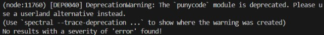
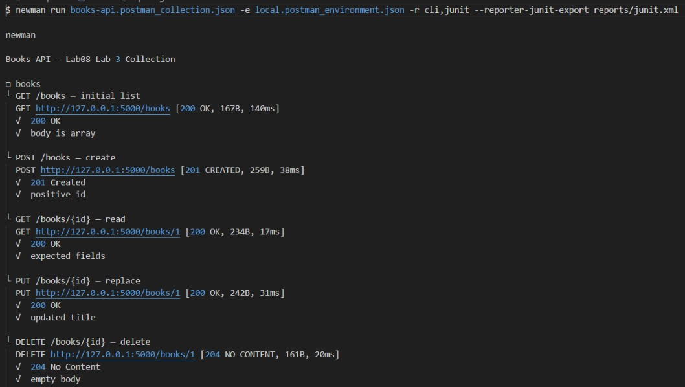
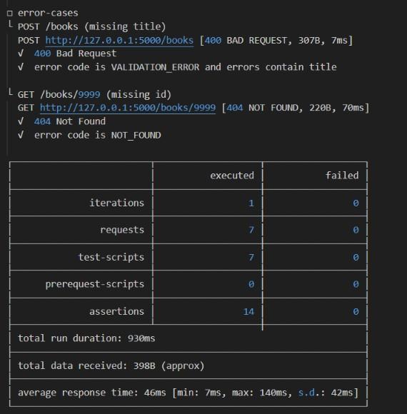

# Minh chứng thực hành Lesson 8 (Lab 2, Lab 3, Lab 4)

---

## 1. Lab 2 — Lint OpenAPI bằng Spectral

- **File đặc tả đã sửa:** [lab_02/openapi.yaml](lab_02/openapi.yaml)
- **Ruleset & Custom Rule:** [lab_02/.spectral.yml](lab_02/.spectral.yml)
- **Output log:** [lab_02/reports/spectral_output.log](lab_02/reports/spectral_output.log)
- **Giải thích chi tiết & câu hỏi lý thuyết:** [lab_02/README.md](lab_02/README.md)

### Ảnh minh chứng Lab 2:

---

## 2. Lab 3 — Kiểm thử tự động với Postman & Newman

- **Collection:** [lab_03/books-api.postman_collection.json](lab_03/books-api.postman_collection.json)
- **Environment:** [lab_03/local.postman_environment.json](lab_03/local.postman_environment.json)
- **Báo cáo JUnit XML:** [lab_03/reports/junit.xml](lab_03/reports/junit.xml)
- **Output log:** [lab_03/reports/newman_output.log](lab_03/reports/newman_output.log)

### Ảnh minh chứng Lab 3:

---

## 3. Lab 4 — Load Test Books API với Locust

- **Script Locust:** [lab_04/locustfile.py](lab_04/locustfile.py)
- **Báo cáo phân tích số liệu:** [lab_04/analysis.md](lab_04/analysis.md)

### Các file báo cáo HTML xuất từ Locust:
- **Kịch bản A (Baseline — 10 users, spawn 2/s, 30s):** [lab_04/reports/A.html](lab_04/reports/A.html)
- **Kịch bản B (Load test — 50 users, spawn 5/s, 60s):** [lab_04/reports/B.html](lab_04/reports/B.html)
- **Kịch bản C (Spike test — 200 users, spawn 50/s, 30s):** [lab_04/reports/C.html](lab_04/reports/C.html)

### Bảng tóm tắt số liệu đo thực tế:

| Kịch bản | Users | Spawn rate | Duration | Tổng Reqs | p50 (ms) | p95 (ms) | Failure rate | RPS |
|:---|---:|---:|---:|---:|---:|---:|---:|---:|
| **A (Baseline)** | 10 | 2/s | 30s | 130 | 13 ms | 380 ms | 0.00% (0/130) | 4.61 |
| **B (Load test)** | 50 | 5/s | 60s | 1,364 | 13 ms | 48 ms | 0.07% (1/1,364) | 23.32 |
| **C (Spike test)** | 200 | 50/s | 30s | 2,733 | 28 ms | 210 ms | 0.18% (5/2,733) | 96.08 |
